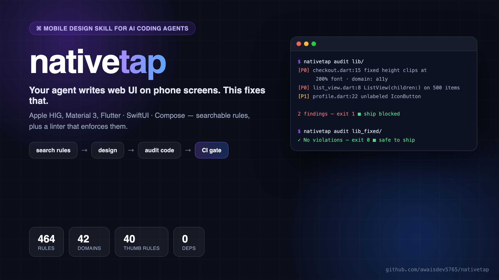
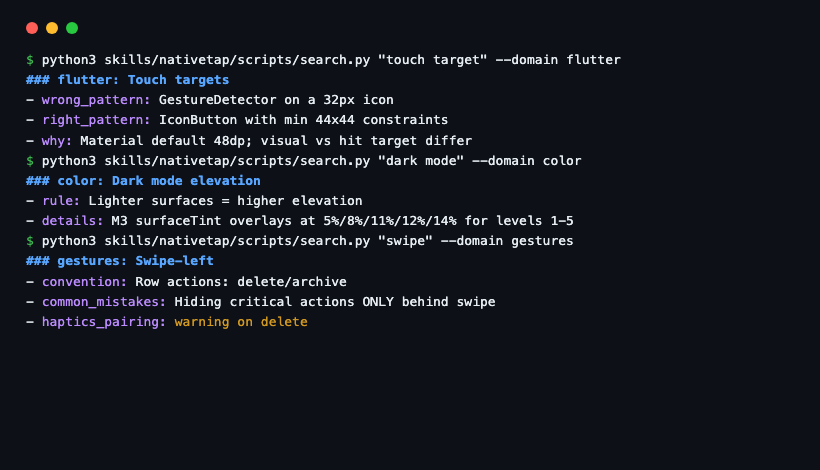

# 📱 nativetap

**Mobile UI/UX design intelligence for AI coding agents.**

Your AI writes great web UI. On phone screens it guesses — buttons in
thumb-unreachable corners, lists that jank, back gestures that break, dark
mode that fails contrast. nativetap is the fix: **461 curated mobile design
rules your agent searches before writing any UI.**

[](https://claude.com/claude-code)
[](mcp/README.md)
[](https://github.com/awaisdev5765/nativetap/actions/workflows/ci.yml)
[](LICENSE)
[](https://github.com/awaisdev5765/nativetap/releases)

Works with **Claude Code, Cursor, Codex, Windsurf, Antigravity, Kiro, Copilot**
— any agent that reads SKILL.md files, plus any MCP client.



```bash
# What your agent knows after install:
$ python3 search.py "keyboard covers field"
→ the exact fix in Flutter, SwiftUI, AND Android — with typical sizes
```



## Why nativetap

Existing design skills are web-first. The biggest one (150k+ ⭐) covers 22
stacks — but mobile is one row in its data, and its flagship content is
Tailwind, React, and landing pages. Meanwhile:

- **2M+ Flutter developers** get shallow coverage
- iOS HIG and Material 3 are *platform contracts*, not style suggestions
- Mobile has hard constraints web doesn't: 44pt touch targets, thumb zones,
  safe areas, gesture conflicts, haptics semantics
- Store rejection is a real tax (icon sizes, data-safety forms)

nativetap is **exclusively about what users touch with their thumbs** — and
it's the design stage of a complete shipping pipeline:

```
nativetap (design) → prism_doctor (code audit) → shipcheck (launch audit)
```

## Install

**Claude Code / Antigravity / Kiro** (plugin manifest included):

```bash
git clone https://github.com/awaisdev5765/nativetap.git ~/.claude/skills/nativetap
```

Or into a single project:

```bash
git clone https://github.com/awaisdev5765/nativetap.git .claude/skills/nativetap
```

**Cursor / Codex / Windsurf:** copy `SKILL.md` + `data/` + `scripts/` +
`references/` into your agent's rules directory — the format is the
cross-agent SKILL.md standard. Cursor users: the repo ships a
[`.cursorrules`](.cursorrules) too — just clone and open the folder.

**Any MCP client** (Claude Desktop, Claude Code, Cursor, Codex, …):

```json
{
  "mcpServers": {
    "nativetap": {
      "command": "python3",
      "args": ["/absolute/path/to/nativetap/mcp/server.py"]
    }
  }
}
```

Exposes `search_mobile_rules`, `list_domains`, and `thumb_rules` tools —
see [`mcp/README.md`](mcp/README.md). Zero dependencies.

**Verify it works:**

```bash
python3 .claude/skills/nativetap/scripts/search.py "touch target" --max-results 1
```

## Audit your own code (new)

```bash
# Scan a project for mobile rule violations (Dart, Swift, Kotlin):
python3 .claude/skills/nativetap/scripts/audit.py lib/

# P0 violations exit 1 — use it as a pre-commit or CI gate:
python3 .claude/skills/nativetap/scripts/audit.py lib/ || echo "fix P0s before shipping"
```

Catches web-instinct violations: fixed heights around text (clips at 200%
font scale), top-row primary actions (thumb-unreachable),
`resizeToAvoidBottomInset: false`, per-keystroke validation errors,
raw hex colors, `ListView(children:)` for dynamic data, unlabeled
`IconButton`s, `fullScreenCover` overuse, `ignoresSafeArea(.all)`.

## Usage

Once installed, your agent picks it up automatically when you design or
review mobile UI. You can also drive the search directly:

```bash
# Search everything:
python3 .claude/skills/nativetap/scripts/search.py "touch target"

# Search one domain:
python3 .claude/skills/nativetap/scripts/search.py "list performance" --domain flutter
python3 .claude/skills/nativetap/scripts/search.py "dark mode" --domain color

# Restrict to your stack (routes to the ~26 domains that matter):
python3 .claude/skills/nativetap/scripts/search.py "swipe" --stack flutter
python3 .claude/skills/nativetap/scripts/search.py "tab bar" --stack swiftui

# What data exists / how many rows:
python3 .claude/skills/nativetap/scripts/search.py --list-domains
python3 .claude/skills/nativetap/scripts/search.py --stats
```

In conversation, just ask your agent:

> "Is this list implementation going to jank?" → searches `flutter` domain
> "What's the iOS convention for destructive swipe actions?" → searches `hig-ios`
> "Make my dark mode correct" → searches `color`, checks the 40 rules P0

## What's inside

| Data domain | Contents |
|---|---|
| **The 40 Thumb Rules** | Priority P0–P5, each with the exact numbers |
| `flutter` | 16 wrong→right patterns: lists, images, forms, state, navigation |
| `swiftui` | 10 patterns: NavigationStack, ownership, insets, accessibility |
| `kotlin` | 10 patterns: Compose perf, ViewModel, predictive back |
| `hig-ios` | Apple component specs: nav bars, sheets, alerts, swipe actions |
| `material3` | M3 specs: FABs, nav bar, chips, tonal elevation |
| `gestures` | Convention per gesture + haptics pairing + common mistakes |
| `safe-areas` | Notch/Island/home-indicator/keyboard in all 3 frameworks |
| `typography` | Mobile type scale with pt/sp + Flutter tokens |
| `color` | Dark mode rules, dynamic color, contrast, semantic tokens |
| `motion` | Transition specs with exact durations per platform |
| `icons` | Every icon size: iOS/Android/watch/store |
| `styles` | 49 mobile visual styles with when-to-use/avoid |
| `a11y` | Screen reader, focus order, 200% type, color-blind safety |
| `performance` | Cold start, jank, image decode, memory, battery — with numbers |
| `forms` | Keyboard types, autofill, OTP, validation timing |
| `components` | Measurable specs: bar heights, row heights, FAB, sheets |
| `notifications` | Permission timing, channels, deep links, badges |
| `tablet-foldable` | Two-pane 600dp+, hinge, stylus, shortcuts |
| `store` | Screenshot strategy, keywords, feature graphic, A/B tests |
| `navigation` | 10 IA patterns with tradeoffs |
| `offline` | Cache-first UI, retry backoff, optimistic updates |
| `onboarding` | Time-to-value, progressive disclosure, retention hooks |
| `monetization` | Paywall timing, trials, restore, compliant CTAs |
| `widgets-watch` | Home widgets, WidgetKit budgets, watch complications |
| `animations` | Springs, easing, stagger, shared elements |
| `images` | Formats, sizing, blurhash, video, camera |
| `security` | Biometrics, keychain, SSL pinning, FLAG_SECURE |
| `deep-links` | Universal/App Links, deferred links |
| `push` | Token rotation, foreground behavior, throttling |
| `i18n` | RTL, plurals, text expansion, Arabic digits |
| `testing` | Golden tests, a11y audits, device matrix |
| `release` | Staged rollout, crash-free gates, hotfix lanes |
| `camera` | Permissions, warm-up, barcode scanning |
| `maps` | Battery discipline, clustering, camera handoff |
| `audio-haptics` | Haptic vocabulary, silent mode, audio focus |
| `compose3` | Modern Jetpack Compose: typed nav, stable state, previews |
| `visionos` | Spatial UI: gaze+pinch, comfort, ornaments |
| `iap` | StoreKit 2, pending transactions, refunds, restore |
| `errors` | Human error copy, retries, inline form errors |
| `app-clips` | App Clips / Instant Apps patterns |
| `voiceover` | 12 screen-reader recipes |
| `charts` | fl_chart / Swift Charts / Vico, zero-axis rule |

Zero dependencies. Pure CSV + a search script. Works offline.

## The 40 Thumb Rules (sneak peek)

| Priority | Rule | Numbers |
|---|---|---|
| **P0** | Touch targets | ≥ 44×44pt iOS / 48×48dp Android |
| **P0** | Contrast | ≥ 4.5:1 body — check BOTH light and dark mode |
| **P0** | Dynamic Type | Layout must survive 200% text scale |
| **P1** | Tap feedback | Visible response ≤ 100ms |
| **P1** | Keyboard | Pushes content, never covers the focused field |
| **P1** | Long-press | Reveals, never deletes |
| **P2** | Navigation matches platform | iOS tabs+back-swipe / Android top bar+system back |
| **P2** | Haptics | Mark state changes, never decorate |
| **P3** | Form labels | Above fields, always visible |
| **P5** | Cold start | ≤ 2s to first meaningful paint |

All 40 with rationale in
[`references/thumb-rules.md`](.claude/skills/nativetap/references/thumb-rules.md).

## Data freshness

Fair question: *do the CSVs go stale when HIG or Material 3 update?*

Every source is fingerprinted and version-stamped:

- [`data/VERSION.json`](.claude/skills/nativetap/data/VERSION.json) — last
  reviewed date + which upstream docs each domain was verified against
- A monthly CI workflow re-hashes the Apple HIG and Material 3 pages; when
  they change, a review issue opens automatically
- Updates land as auditable diffs — every rule stays traceable to its source

## FAQ

**Are iOS and Android conventions kept apart, or averaged?**
Kept apart. Every cross-platform domain has per-platform columns (iOS /
Android / Flutter / SwiftUI / Compose), so the agent gets the exact HIG or
Material spec — not a mushy middle. Where platforms genuinely agree, the row
is shared; where they differ (back gesture, nav patterns), each keeps its
own rule.

**Does this replace a designer?**
No — it stops the AI from breaking the platform's hard rules (thumb reach,
contrast, safe areas, gesture conflicts). The taste is still yours.

**Why CSVs and not a bigger format?**
Plain data + a 150-line dependency-free search script = works offline, in
any agent, forever. No SDK, no lock-in, no breakage.

## The pipeline

nativetap is one third of a full "vibe coder ships a real app" toolkit:

| Stage | Tool | What it checks |
|---|---|---|
| **Design** | **nativetap** (this skill) | HIG/M3 correctness, thumb ergonomics, platform patterns |
| Code | [prism_doctor](https://pub.dev/packages/prism_doctor) | Hardcoded colors, magic numbers, deprecated imports |
| Launch | [shipcheck](https://pub.dev/packages/shipcheck) | Store listings, privacy, screenshots, release notes |

## A worked example

[`example/checkout_screen/`](example/checkout_screen/) shows a Flutter
checkout screen written **without** nativetap (web instincts: top-right
submit, 32pt targets, fixed heights) and the **same screen with it** — every
fix cited to the exact row that drove it.

## Contributing

The data files are the product — PRs adding rows to the CSVs (with correct,
verified platform data) are very welcome. Each row is small and sourced, so
a PR per HIG/Material release is cheap and reviewable. Search script is
dependency-free Python 3.

## License

MIT — see [LICENSE](LICENSE).
